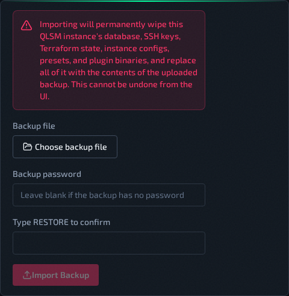

# Backup & Restore

QLSM can export the full operational state of this instance — database, SSH keys, Terraform state, instance configs, presets, downloaded plugins, hook binaries, and addons — into a single downloadable file, and restore that file onto another QLSM instance. This is the supported way to migrate QLSM to a new host without losing track of the QLDS servers it manages.

Backup & Restore is found at **Settings → Backup & Restore**.

If you configure `ADDON_PACKAGES_DIR`, give installed add-ons a dedicated directory such as the default `data/addon-packages`. Keep that directory and its neighboring maintenance lock directory separate from other backup directories such as `configs`. Use direct relative or absolute paths for both directories. QLSM rejects either path if any component is `..` or a symbolic link.

## What's Included

- The database: hosts, instances, users, preset metadata, your external API key, app settings (including a saved Vultr API key), and plugin binary descriptions.
- SSH keys used to manage your hosts.
- Terraform state for every provisioned host.
- Installed addon packages, retained Custom runtime releases and host pins, and addon enablement and settings at global, host, and instance scope.
- Instance configs, non-built-in presets, plugins downloaded from [plugin repositories](../operations/plugin-repositories.md), and hook binaries.

Built-in presets and QLSM's built-in plugins are not included — they ship with QLSM itself and are restored from the Docker image on the new host.

`REDIS_PASSWORD` and `SECRET_KEY` are intentionally **not** included. Each QLSM host generates its own, and a mismatch after restore only means you'll need to sign in again — it doesn't affect any data.

## Export A Backup

1. Go to **Settings → Backup & Restore**.
2. Optionally set a **Password** and confirm it.
3. Click **Export Backup**. The `.qlsmbak` file downloads to your browser.

Exports and restores are blocked while a host runtime update or rollback is pending, running, or awaiting recovery. Wait for the operation or its recovery to finish before making a backup or restoring one.

### When To Use A Password

A backup contains SSH private keys, your Vultr API key, user login credentials, per-instance RCON/stats passwords, and any credentials saved in addon settings. **Use a password** unless you're exporting for an immediate, trusted, local-only transfer (e.g. copying straight onto a USB drive you control).

If you leave the password blank, QLSM lists examples of sensitive data stored in plain text and asks you to acknowledge the risk before the download starts.

Backups are encrypted with a password-derived key (Scrypt + AES-256-GCM) when a password is set. There is no way to recover a forgotten backup password — QLSM does not store it anywhere.

## Import A Backup

Importing is **destructive**: it wipes this QLSM instance's database and every item listed under [What's Included](#whats-included) and replaces it all with the contents of the archive. Only import into a QLSM instance whose current state you're OK losing — typically a freshly installed one (see [Migrate To A New Host](#migrate-to-a-new-host) below).

1. Go to **Settings → Backup & Restore**.
2. Under **Import**, choose the `.qlsmbak` file.
3. Enter the backup's password, if it has one.
4. Type `RESTORE` in the confirmation field.
5. Click **Import Backup**.

**Restart QLSM after every successful restore, before managing restored hosts.** Restart all QLSM application and worker processes so they load the restored addons. For a standard Docker Compose installation, run `docker compose restart web worker poller rcon` from the installation directory. Sign in with the credentials from the restored backup.

The restore replaces the destination's addon state, including scoped settings for existing hosts and instances. A backup that includes addon state restores the recorded enablement and settings. An older backup that omits addon state clears destination addon state and leaves restored providers disabled by default. After restarting QLSM, re-enable and configure the addons and Custom runtime providers you use.

Before making any changes, QLSM saves a safety-net snapshot of the instance's own prior state to `backup_snapshots/` on the server (the 3 most recent are kept, older ones are pruned automatically). Treat these the same as any backup file — they contain the same sensitive material (SSH keys, API keys, credentials).

## Migrate To A New Host

Use this flow to move QLSM itself to a new machine while keeping every QLDS server it manages running and reachable.

1. On the **old** QLSM instance, export a backup (with a password — this file will briefly contain your SSH keys and Vultr API key).
2. Follow [Installation](../getting-started/installation.md) to stand up a fresh QLSM instance on the new host. Do not add any hosts or instances to it yet.
3. On the **new** instance, go to **Settings → Backup & Restore** and import the backup you exported in step 1.
4. Restart all QLSM application and worker processes, then sign in with the credentials from the restored backup. Re-enable and configure addons if the restore reports an older archive.
5. Confirm your hosts and instances appear exactly as they did on the old instance.
6. Spot-check that automation still works: open a host's detail view and confirm Terraform recognizes its existing VM (no unexpected "not found" or plan-to-recreate state), and use the RCON console or Edit Configs on an instance to confirm SSH still connects.

With the restored Terraform state and SSH keys, the new QLSM installation can manage your existing cloud VMs and standalone hosts using their existing provisioning and SSH credentials.

## Related Pages

- [Installation](../getting-started/installation.md)
- [User Management & API Keys](user-management.md)
