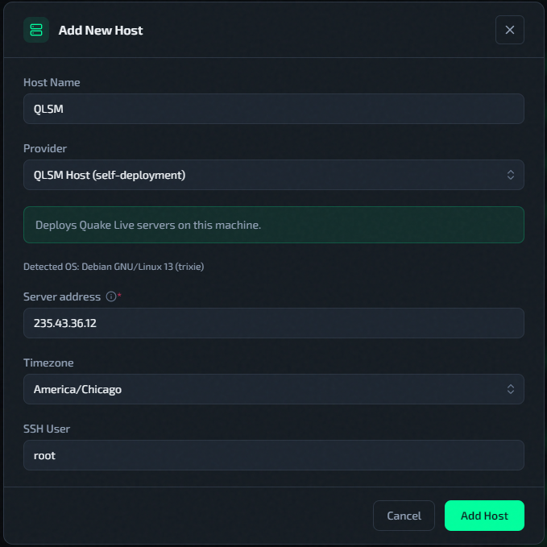
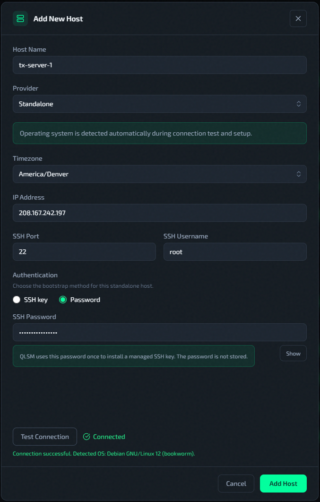
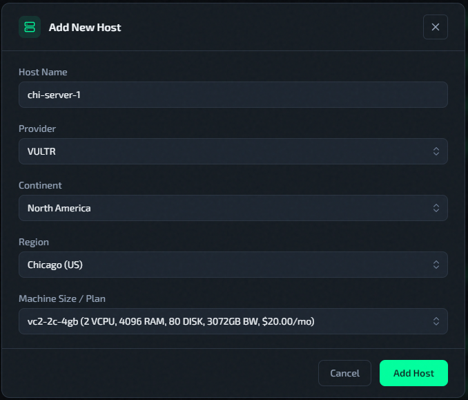

# Add A Host (Cloud Or Standalone)

Hosts are added from **Servers** -> **Add New Host**. 

## Server Runtime

Every host runs one of two Quake Live server runtimes, chosen from the **Server Runtime** radio buttons on the Add Host form, right below **Provider**:

- **minqlx** — the original runtime, and every plugin QLSM ships today. New Vultr hosts are provisioned on **Ubuntu 24.04**, so they can later be upgraded to minqlxtended. (Vultr hosts created before v1.53.0 run Debian 12 and can't be upgraded.)
- **minqlxtended** — a hard fork with no plugin compatibility with minqlx. Provisions/expects **Ubuntu 24.04**, and requires **Python 3.12 or newer** on the target machine.

For Vultr cloud hosts, QLSM provisions the matching OS image automatically — there's no separate OS choice.

For **standalone** hosts, the target machine's OS is auto-detected during connection testing, and creating a minqlxtended host additionally requires the detected Python to already be 3.12 or newer — the Add Host form rejects the submission with an explanation if it isn't.

For a **self** host, there's no equivalent inline check: QLSM has no way to detect the local machine's Python version before creating the host record. The form accepts the submission, the host is created, and setup runs in the background — if the machine's Python turns out to be older than 3.12, setup fails and the host lands in **Error** status instead of **Active**. If you're creating a minqlxtended self host, confirm `python3 --version` is 3.12 or newer on that machine yourself before you submit the form.

**This choice is fixed at creation.** The only way to change it afterwards is the [Upgrade to minqlxtended](../operations/host-actions-menu.md#upgrade-to-minqlxtended) action, which moves a minqlx host on Ubuntu 24.04 or newer to minqlxtended and cannot be undone from the UI. To move a host back, save a preset from it and deploy a new host with minqlx selected.

**Presets carry across runtimes.** A preset saved from a minqlx instance can be loaded onto a minqlxtended host, and vice versa: your server config, map pool, and other settings come across intact, while plugins that can't run on the target runtime are removed — with a replacement offered where one exists — before you confirm the load. See [Presets And Default Config](../presets/overview.md) for the details.

## Self-Host Deployment

The **QLSM Host (self)** provider runs game servers on the same machine that runs the QLSM Docker stack. Useful when you already have a spare Linux box and don't want a separate VM just for game servers.

1. Set **Provider** to `QLSM Host (self)`.
2. The form shows the detected OS, pre-fills the inferred SSH user, and may pre-fill **Server address** if `QLSM_HOST_IP` is configured. Verify these values before continuing.
3. Set **Timezone**.
4. Click `Add Host` button to submit the form.
5. Wait until setup finishes and host is **Active**.




QLSM generates and manages its own SSH key for self-host automation. Your personal SSH keys are never accessed.

For self-host setup, the SSH user can be `root` or another account with passwordless `sudo` privileges. QLSM uses that account as the management login for automation tasks.

During setup, QLSM creates a dedicated `ql` system user for Quake Live files and services. Game server assets and processes run under `ql`, but QLSM continues to connect as the configured management account when it needs to automate the host later.

Only one `QLSM Host (self)` deployment may exist at a time.

## Custom Runtime

Choose **Custom** when adding a Standalone host with an installed, enabled runtime addon. Confirm the provider name and approved build shown in Add Host. A Custom host stays with its original provider and plugin API. The host must meet that release's OS, architecture, and Python requirements.

QLSM pins the provider, release digest, and plugin API. Installing a newer version of the addon makes its approved release available after QLSM restarts and the addon is active. Existing hosts keep their pins until you confirm a release change. **Re-run Host Setup** installs the pinned build. If the provider or pinned bundle is unavailable, restore it before rerunning setup.

The provider's plugin API determines which presets and plugins QLSM uses. The pinned addon supplies its Python plugin dependencies during setup. QLSM skips the built-in per-instance requirements file on Custom hosts.

### Update or roll back a Custom release

1. Open the host's **Host Details** and click **Update Custom runtime**.
2. Review the pinned build and SHA-256, the available release choices, and the affected instance states. An approved update must come from the same provider and match the pinned release's plugin API and platform. When a previous release from a successful change is available for the current pin, you can choose that release to roll back.
3. Confirm the selected release and monitor host status and [Host Logs](../operations/host-logs.md). If the host or available releases changed after you opened the preview, reload it and review the choices again.

The host must be **Active**, its provider and pinned bundle must be available, and each instance must be **Running** or **Stopped**. QLSM stages the selected bundle before interrupting services and keeps both release bundles. During the change, running instances have downtime while QLSM updates their service definitions, restarts them, and verifies they are ready. Stopped instances stay stopped. QLSM preserves instance configs, plugins, and game data.

If a change fails after QLSM starts stopping instances, QLSM attempts to restore the original pin, service definitions, and running or stopped states. If it cannot verify recovery, the host stays in **Error** and other host changes remain blocked while QLSM retries. Check **Host Logs** for progress.

QLSM rejects global disable, uninstall, or replacement with a package that removes the runtime capability while any Custom host references the provider. This applies even when the host has no instances or is in **Error**. Release updates for the provider and scoped settings edits are still available.

## Standalone Workflow

1. Set **Provider** to `Standalone`.
2. Fill:
   * Host Name
   * IP Address
   * SSH Port
   * SSH Username
   * SSH Private Key (or password for bootstrap — QLSM installs a managed key then discards the password)
   * Timezone
3. Run **Test Connection** and confirm it shows **Connected**. OS is auto-detected during the connection test.
4. Click `Add Host` button to submit the form.
5. Wait until setup finishes and host is **Active**.




## Vultr Cloud Deployment

### Prerequisites

Create a Vultr API key by following Vultr's official guide: [Create New API Key](https://docs.vultr.com/platform/other/api/other-user/create-api-key). Copy and store the key immediately because Vultr only shows it once.

Set `VULTR_API_KEY` in the QLSM environment before using Vultr provisioning.

**One-liner install** — pass the key inline:

```bash
VULTR_API_KEY=your_vultr_api_key bash <(curl -fsSL https://raw.githubusercontent.com/dngrtech/qlsm/main/qlsm-install.sh)
```

**Git clone / manual install** — edit `.env` before starting:

```bash
# In .env, find and uncomment this line:
VULTR_API_KEY=your_vultr_api_key
```

Then start with `docker compose up -d`.

You can also set or change the Vultr API key later without editing `.env`, from **Settings → Vultr API Key**. A key saved there takes precedence over `.env` and travels with a [global backup](../administration/backup-restore.md).

One-line install example with both a domain and Vultr provisioning:

```bash
SITE_ADDRESS=qlsm.example.com VULTR_API_KEY=your_vultr_api_key bash <(curl -fsSL https://raw.githubusercontent.com/dngrtech/qlsm/main/qlsm-install.sh)
```

### Workflow

1. Set **Provider** to `VULTR` cloud provider.
2. Select **Continent**, **Region**, and **Machine Size / Plan**.
3. Click `Add Host` button to submit the form.
4. Wait until host status reaches **Active**.



Cloud hosts inherit timezone from selected region. That timezone is later used by [Configure Auto-Restart](../operations/auto-restart.md).

## Timezone Requirement

Timezone is operational, not cosmetic.

- [Configure Auto-Restart](../operations/auto-restart.md) executes in host local timezone.
- Wrong timezone means restart at the wrong local hour.
- Wrong restart time delays Workshop item refresh on running servers.

Continue with: [Configure Auto-Restart](../operations/auto-restart.md)

## Related Pages

- [Deploy A New Instance](deploy-new-instance.md)
- [Presets And Default Config](../presets/overview.md)
- [Host Actions Menu](../operations/host-actions-menu.md)
- [Deployment Troubleshooting](../help/deployment-troubleshooting.md)
