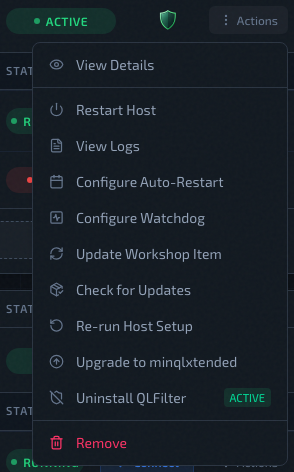

# Host Actions Menu

Open from host row **Actions** in the Servers page.

## Actions In This Menu

- **View Details**: opens host details drawer.
- **[View Logs](host-logs.md)**: opens this host's provisioning and setup log. Start here when a host is in **Error**.
- **Restart Host**: queues host reboot flow. If the host takes longer than expected to come back and briefly shows **Error**, QLSM keeps probing it and restores it to **Active** automatically once it's reachable again — no manual action needed in that case.
- **[Configure Auto-Restart](auto-restart.md)**: opens restart schedule modal.
- **[Configure Watchdog](watchdog.md)**: turns on automatic restart of any instance on this host whose game loop has frozen. Off by default.
- **[Update Workshop Item](update-workshop-item.md)**: triggers workshop update on this host.
- **[Check for Updates](check-for-updates.md)**: compares this host's plugins with the versions QLSM ships and lets you pick which files to update.
- **[Install/Uninstall QLFilter](../features/qlfilter.md)**: depends on current QLFilter state.
- **[Upgrade to minqlxtended](#upgrade-to-minqlxtended)**: moves a minqlx host to minqlxtended. Only shown on minqlx hosts.
- **Re-run Host Setup**: re-applies the host configuration playbook on an existing host.
- **Delete / Remove**: removes host from management (or destroys cloud host).

## Rename A Host

Open **View Details** and click the pencil next to the host name. Enter the new name and save.

- **Cloud hosts**: the machine's hostname is renamed too.
- **Standalone hosts**: by default only the name inside QLSM changes; the machine's own hostname and `/etc/hosts` are left alone, since the machine isn't QLSM's. Tick **Also rename the machine itself** under the name field if you want QLSM to change them as well.

The rename runs as a background task; other host actions wait until it finishes. If it fails, the host shows **Error** and the reason is in [Host Logs](host-logs.md).

## Notifications

The bell in the top navbar collects notifications from QLSM and from installed addons (for example a host monitoring addon reporting a slow host). The badge shows the unread count and refreshes every 30 seconds while the tab is visible. Open the bell to see the latest 20; clicking one marks it read and opens its page, and **Mark all read** clears the badge. Read state is shared by all users, and notifications are deleted 30 days after their last update.

## What QLFilter Is

QLFilter is a host-level anti-DDoS filter. It uses eBPF/XDP to drop reflection garbage (DNS, SSDP, and similar noise) at the network driver level before it ever reaches QLDS. One installation covers all instances on the host.

For a full explanation: [QLFilter](../features/qlfilter.md)

Operationally:

- Use **Install QLFilter** on new production hosts.
- Use **Uninstall QLFilter** only when you intentionally want it removed.

## QLFilter Behavior In Menu

The QLFilter action changes based on current QLFilter status:

- `not_installed`, `error`, `unknown` -> **Install QLFilter**
- `active`, `inactive` -> **Uninstall QLFilter**
- `installing`, `uninstalling` -> action shows busy state and is locked

While QLFilter is installing/uninstalling, other host management actions are also blocked.

## Update Workshop Item: Practical Use

1. Open **Update Workshop Item** from host actions.
2. Enter numeric Workshop Item ID.
3. Optionally pick running instances for automatic restart after update.
4. Submit and monitor instance status.

Full guide: [Update Workshop Item](update-workshop-item.md)

This is commonly paired with scheduled restart policy:
[Configure Auto-Restart](auto-restart.md)

## Re-run Host Setup

**Re-run Host Setup** re-applies the host configuration playbook to an existing host without reprovisioning it. Use this after a platform update that changes how the host is configured, when a previous setup run failed partway through, or to pick up infrastructure changes on an already-active host.

The action is available when the host status is **Active** or **Error**. While it runs, the host enters **Configuring** status and other management actions are blocked.

> **Self-hosted hosts** — Re-run Host Setup is available but does not modify Redis connectivity (self-host always uses TCP). On **cloud** and **standalone** hosts it applies the full setup, including any Redis configuration changes introduced in a platform update.

Re-running host setup also refreshes the host's game and RCON port allow-list, so run it if a host set up on an older platform version needs the full range of instance slots to be reachable.

After the playbook completes, the host returns to **Active** status.

> **Running instances are automatically restarted** after a successful run. Plan for brief server downtime if you run this on a live host.

## Upgrade To Minqlxtended

**Upgrade to minqlxtended** moves an existing minqlx host to minqlxtended, the newer runtime, without rebuilding the host. It is also in the host drawer. It works on one host at a time and upgrades every instance on that host together.

### When it is available

The action only appears on hosts that run minqlx. It is greyed out, with an info icon that tells you why, unless:

- the host is **Active**;
- the host runs **Ubuntu 24.04 or newer** (minqlxtended needs Python 3.12; Debian 12 hosts cannot be upgraded);
- every instance on the host is **Running** or **Stopped**. An instance in Error, Idle, Updated or any in-progress state blocks it. Fix or wait for that instance first.

Hover the info icon to see the reason for your host.

### What you see before anything happens

Clicking the action opens a dialog straight away. Nothing is stopped until you confirm. For each instance on the host the dialog lists what happens to its plugins:

- standard plugins you have not changed are swapped for minqlxtended's version silently;
- a plugin you edited or that is outdated, where minqlxtended has its own version, has a checkbox: tick it to use minqlxtended's version, leave it unticked to drop the plugin;
- an enabled plugin minqlxtended has no version of is listed without a checkbox. It will be dropped and switched off.

If nothing needs a decision, the dialog is a plain confirmation. **Cancel** changes nothing. If you or someone else edits an instance while the dialog is open, the upgrade refuses to start and asks you to reopen it, so what you approved is what gets applied.

### What happens when you confirm

The host shows **Configuring** and other actions on it are blocked. QLSM saves a copy of every instance, stops every instance, builds minqlxtended, converts each instance's configuration with your answers, and starts it again. Instances that were running are started again; **instances that were stopped stay stopped.** Expect downtime for the whole host while this runs. Progress and results are in [Host Logs](host-logs.md).

Each instance also gets a fallback preset named `pre-minqlxtended-...` in the preset manager. You do not need it for a normal rollback, but you can load it by hand if you ever want the old configuration back.

### If something fails

If the build, a stop, a conversion or any instance's start fails, QLSM **rolls the whole host back**: the host returns to minqlx, every instance gets its previous config and plugins back, and each one is running or stopped exactly as before. If the failure came before anything was stopped, the host simply returns to Active. A plugin that merely fails to load inside a running server does not count as a failure.

If a rollback cannot finish, the host shows **Error** and the log lists the instances that did not come back. The host stays on minqlx. QLSM retries automatically every few minutes until the host is reachable and the rollback completes, including after a restart of QLSM itself, and other actions on the host stay blocked until it completes. There is no manual retry button.

Upgrading is one way. QLSM has no downgrade action; the old minqlx build stays on the host, which is what makes rollback possible.

## Related Pages

- [Instance Actions Menu](instance-actions-menu.md)
- [Update Workshop Item](update-workshop-item.md)
- [Check For Plugin Updates](check-for-updates.md)
- [Configure Watchdog](watchdog.md)
- [Host Logs](host-logs.md)
- [Deployment Troubleshooting](../help/deployment-troubleshooting.md)
